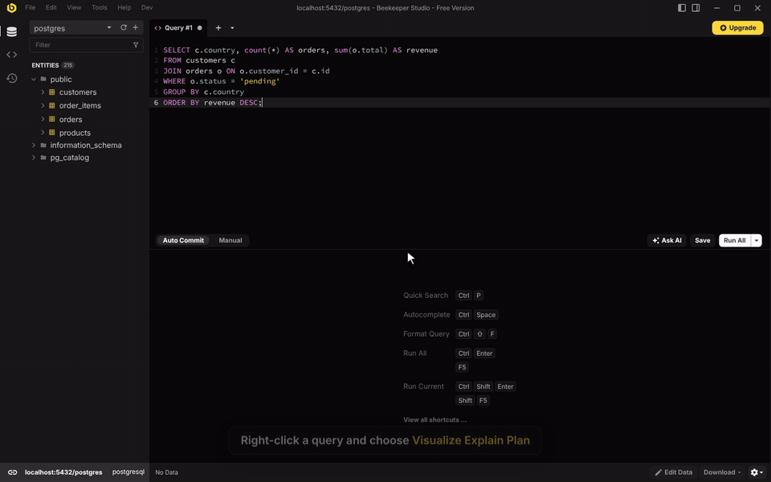
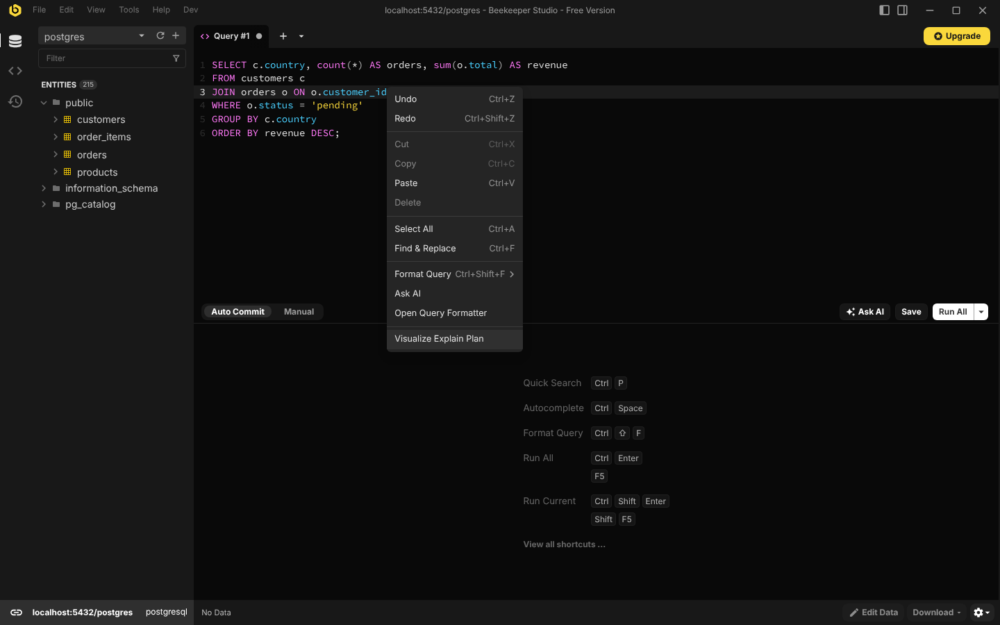
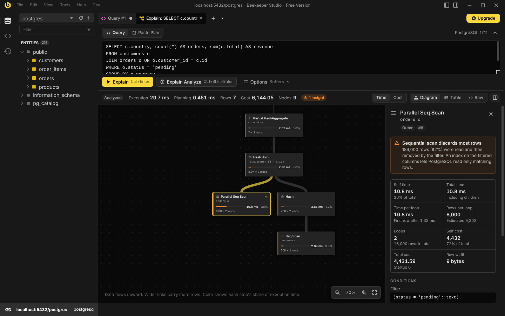
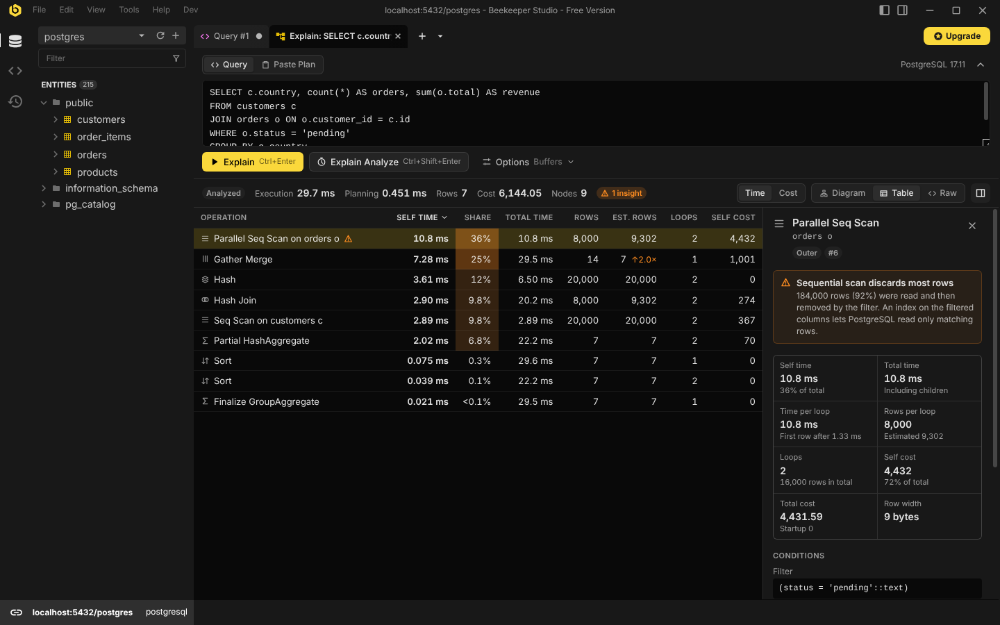
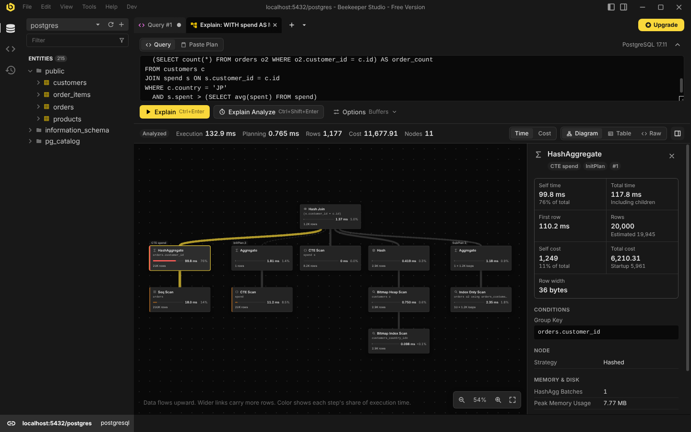
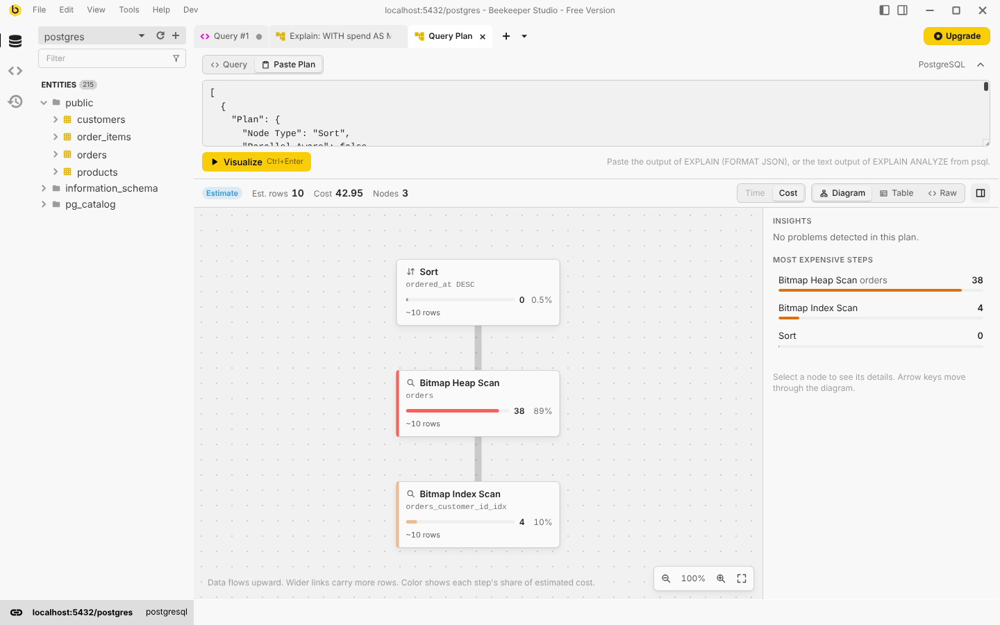

# Explain Visualizer

A [Beekeeper Studio](https://www.beekeeperstudio.io) plugin that turns query
execution plans into an interactive diagram, so the slow part of a query is
easy to find.



- **Diagram** of the plan, coloured by each step's share of execution time
  (or estimated cost). Wider links carry more rows.
- **Table** view in the style of `explain.depesz.com`, sortable by self time.
- **Details** for every step: self and total time, actual vs. estimated rows,
  loops, costs, conditions, buffers, memory and disk usage, workers.
- **Insights** that point at common problems: sequential scans that discard
  most rows, sorts and hashes spilling to disk, large row misestimates, parallel
  workers that didn't start, slow JIT compilation and more.
- **Raw** plan output, ready to copy or save.

More in the [screenshots](#screenshots) below.

## Supported databases

| Database   | Explain | Explain Analyze | Paste a plan            |
| ---------- | ------- | --------------- | ----------------------- |
| PostgreSQL | Yes     | Yes             | JSON and psql text      |
| MySQL      | Planned |                 |                         |
| SQLite     | Planned |                 |                         |
| SQL Server | Planned |                 |                         |

Tested with PostgreSQL 12, 17 and 18. Other databases are planned; the plugin is
built around a database-neutral plan model so each one only needs an adapter
(see [Adding a database](#adding-a-database)).

## Using it

There are several ways in:

- **Query editor:** click **Explain** in the editor toolbar, or right-click a
  query and choose **Visualize Explain Plan**. The selected text is used, or
  the statement under the cursor.
- **New tab menu:** open **Explain Visualizer**, write a statement and choose
  **Explain** or **Explain Analyze**.
- **Visualize menu:** after running `EXPLAIN ...` yourself, choose
  **Visualize › Explain Visualizer** in the results status bar. The item is
  disabled until the result is a query plan.
- **Results grid:** right-click the plan cell and choose **Visualize Explain
  Plan**. For text output (one row per line), right-click the `QUERY PLAN`
  column header.
- **Paste Plan:** paste JSON or text EXPLAIN output, for example from psql or a
  colleague.



### Explain and Explain Analyze

**Explain** asks the database for its plan without running the statement. It is
always safe, so it runs automatically when the tab opens from the editor.

**Explain Analyze** runs the statement and measures every step. The plugin
sends `EXPLAIN ANALYZE ...; ROLLBACK;` as a single request, so both statements
share one implicit transaction and anything the statement changed is rolled
back. That includes plain `SELECT`s, which can call functions that write. If the
statement fails, the transaction is aborted on its own and the pooled
connection is left clean. Effects outside the transaction, such as sequence
values, are not undone.

Statements that change data (`INSERT`, `UPDATE`, `DELETE`, `MERGE`,
data-modifying CTEs...) are only analyzed after a confirmation. The plugin reads
the statement with a lexer that follows PostgreSQL's own rules for strings,
comments and dollar quotes, and refuses input that contains more than one
statement.

On read-only connections Beekeeper Studio does not allow the `ROLLBACK`, so
statements that change data can only be explained, and Explain Analyze never
runs automatically. A `SELECT` that calls a function which writes is not
detected there, the same as when running it in a query tab.

If the editor text already starts with `EXPLAIN ANALYZE` (or `EXPLAIN (...)`),
the plugin uses those options.

The **Options** menu toggles `BUFFERS`, `VERBOSE`, `SETTINGS` and `WAL`. Options
the server doesn't support are disabled. Statements with `$1` parameters are
explained with `GENERIC_PLAN` on PostgreSQL 16+.

## Screenshots

Explain Analyze, with the slow step selected and an insight about it:



The same plan as a table, sorted by self time:



A query with a CTE, an InitPlan and a SubPlan, each shown as its own branch:



The plugin follows Beekeeper Studio's theme:



## Development

Requires Node.js 22+ and Yarn 1.

```bash
yarn install
yarn dev        # builds with hot reload and links the plugin into Beekeeper Studio
yarn test       # unit tests
yarn build      # type-check and build into dist/
```

`yarn dev` uses [`@beekeeperstudio/vite-plugin`](https://www.npmjs.com/package/@beekeeperstudio/vite-plugin),
which symlinks this folder into Beekeeper Studio's plugin directory.

By default Beekeeper Studio only loads its own allow-listed plugins. To load
this one, add the following to your
[user configuration file](https://docs.beekeeperstudio.io/user_guide/configuration/)
and restart the app:

```ini
[pluginSystem]
disabled = false
```

Then connect to PostgreSQL: **Explain** appears in the query editor toolbar,
**Visualize Explain Plan** in the query editor's context menu and **Explain
Visualizer** in the new tab menu and the results **Visualize** menu.

### Harness

`dev/harness.html` stands in for Beekeeper Studio: it loads the plugin in an
iframe and answers its requests with the same messages the app uses, running
queries against a real PostgreSQL server. It is the quickest way to work on the
UI, try every way the tab can be opened, and switch themes.

```bash
docker run -d --name pg -e POSTGRES_PASSWORD=pw -p 5432:5432 postgres:17
psql postgres://postgres:pw@localhost:5432/postgres -f scripts/fixtures/seed.sql
PG_URL=postgres://postgres:pw@localhost:5432/postgres yarn harness
```

### Tests

- `tests/postgres` parses real plans captured from PostgreSQL 12, 17 and 18
  (`tests/fixtures/postgres`). Each fixture has the same plan in JSON and text
  form, and the tests check both produce the same tree.
- `tests/integration` runs EXPLAIN against a live server, including the rollback
  of analyzed writes. It runs when `PG_URL` is set and is skipped otherwise.
- `tests/state` covers the tab's behaviour with a fake host.

To capture fixtures from another PostgreSQL version, seed it with
`scripts/fixtures/seed.sql` and run:

```bash
PG_URL=postgres://... FIXTURE_PREFIX=pg16- node scripts/fixtures/capture-postgres.mjs
```

## How it works

```
src/
  core/        database-neutral plan model, analysis, layout and formatting
  engines/     one adapter per database family, plus the registry
    postgres/  EXPLAIN builder, JSON and text parsers, timing rules, insights
  host/        everything that talks to Beekeeper Studio
  state/       the tab's state and actions
  components/  Vue components: diagram, table, details, raw view
```

Every adapter converts its database's EXPLAIN output into the `Plan` model in
`src/core/plan.ts`. A `PlanNode` has an operation name, a `kind` (scan, index,
join, sort...), optional estimates (`totalCost`, `estimatedRows`), optional
measurements (`actualRows`, `loops`, times), derived `inclusiveTime`,
`exclusiveTime` and `exclusiveCost`, plus conditions and grouped properties for
the details panel. Every metric is optional, and the UI only shows what an
engine provides.

Self time is engine-specific, so the adapter computes it. PostgreSQL's rules
live in `src/engines/postgres/timing.ts`: per-loop times are multiplied by
loops, parallel workers are counted once, CTE time is charged to the CTE scans
that read it, and an InitPlan's time is charged to the node that evaluates it.

`src/core/analysis.ts` adds what every engine shares: shares of time and cost,
the slowest steps, and row misestimate insights.

### Adding a database

1. Create `src/engines/<name>/` with an object implementing `ExplainEngine`
   (`src/engines/types.ts`):
   - `connectionTypes`: the Beekeeper Studio connection types it handles.
   - `inspect(sql)`: split and classify the statement (does it change data?).
   - `explain(request, runQuery)`: send whatever SQL the database needs and
     parse the result. It may call `runQuery` several times.
   - `canParse` / `parse`: read pasted output and values from the results grid.
   - `options`: toggles shown in the Options menu.
2. Map native operators to `NodeKind`s and fill in whichever metrics exist.
   Call `finishPlan()` from `src/core/analysis.ts` at the end.
3. Register it in `src/engines/registry.ts`, add fixtures captured from a real
   server and tests like the PostgreSQL ones.

Notes for the planned databases:

- **MySQL / MariaDB:** `EXPLAIN FORMAT=JSON` gives estimates. MySQL 8.0.18+
  `EXPLAIN ANALYZE` runs the statement and returns a text tree with actual
  times; MariaDB uses `ANALYZE FORMAT=JSON`. MySQL
  only analyzes `SELECT` and multi-table `UPDATE`/`DELETE`, and Beekeeper
  Studio's MySQL connection may not allow two statements in one request, so the
  rollback approach above needs checking.
- **SQLite:** `EXPLAIN QUERY PLAN` returns `(id, parent, detail)` rows, which
  form the tree. There are no costs or timings; the diagram then shows the
  structure and details only.
- **SQL Server:** `SET SHOWPLAN_XML ON` must be alone in its batch and applies to
  the next batch on the same connection, which `runQuery` does not guarantee.
  `SET STATISTICS XML ON` works in one batch but runs the statement (an actual
  plan). An estimated plan may need a new host API.

## Releasing

1. Update `version` in both `manifest.json` and `package.json`.
2. Push a matching tag, e.g. `git tag v0.1.0 && git push origin v0.1.0`.
3. The release workflow builds, tests and creates a draft GitHub release with
   `manifest.json` and `explain-visualizer-<version>.zip`. Publish the draft.

`yarn build && yarn package` creates the same archive locally.

## License

GPL-3.0. See [LICENSE](LICENSE).
